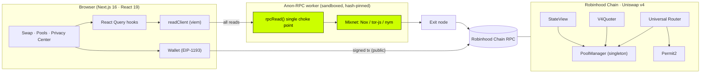
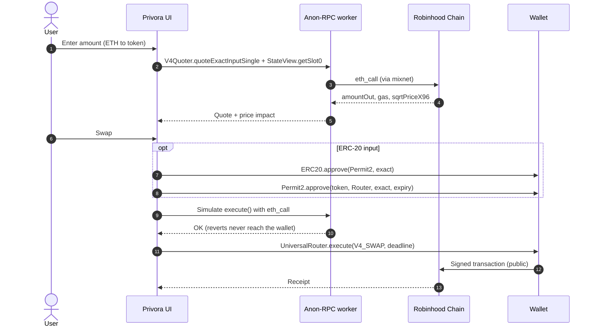
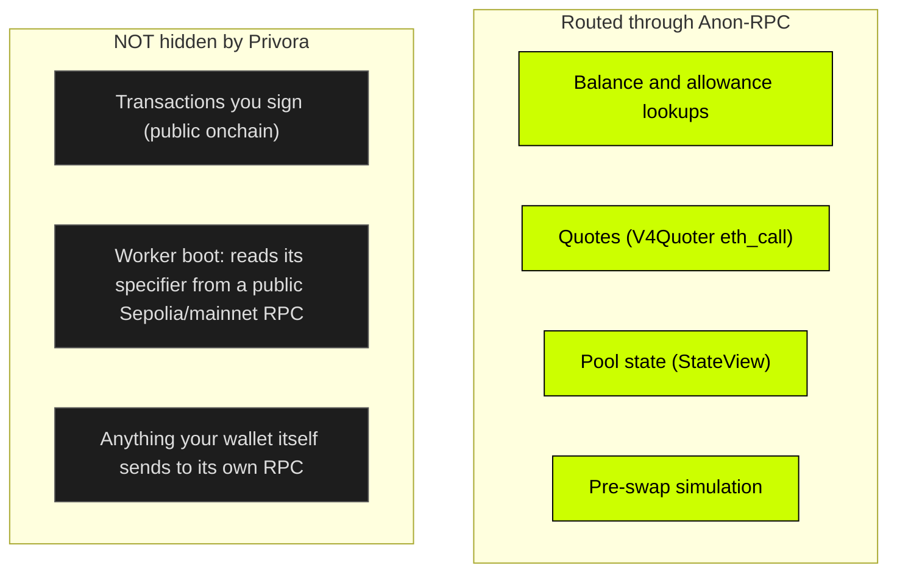
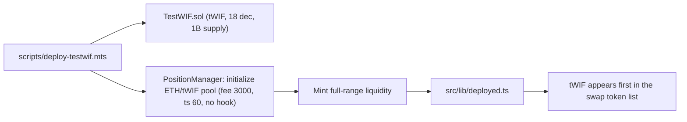
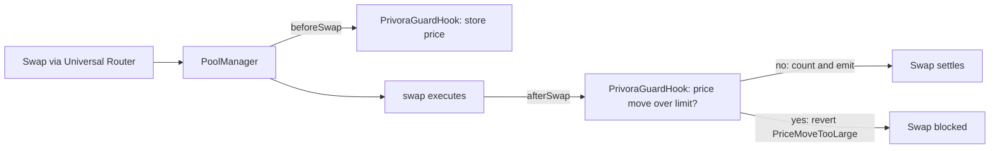

<div align="center">


# Privora

### Swap privately. Read anonymously.

A **Uniswap v4** swap interface for **Robinhood Chain** where every chain read travels through [Anon-RPC](https://github.com/ethereum/anon-rpc), so the RPC provider no longer sees your IP address next to your wallet's queries.

     

**[Live demo](https://privora-v4.vercel.app/)** · Built for the **World is Flat** hackathon on Robinhood Chain · Uniswap v4 + custom Privora Guard hook

</div>

---

## Contents

[Live demo](https://privora-v4.vercel.app/) · [Problem](#the-problem) · [Solution](#the-solution) · [Architecture](#architecture) · [Swap flow](#swap-flow) · [Privacy model](#privacy-model) · [Test $WIF](#test-wif-for-the-demo) · [Guard hook](#privora-guard-hook-v4-hook-extra-feature) · [Quick start](#quick-start) · [Testing](#testing) · [Contracts](#contracts) · [Project layout](#project-layout) · [Limits](#limits) · [Docs](#documentation)

## What is inside

| Part | What it does |
| --- | --- |
| **Private reads** | Every chain read (balances, allowances, quotes, pool state) goes through Anon-RPC and is blocked if the worker is not ready. |
| **Swap UI** | ETH ⇄ token swaps via the Universal Router and Permit2, simulated first. |
| **Privora Guard hook** | A custom Uniswap v4 hook ([details](#privora-guard-hook-v4-hook-extra-feature)) that blocks any single swap moving a pool's price by more than 10%. |
| **Test $WIF** | A demo token with two pools: a plain ETH/tWIF pool and a hooked one (select **tWIF·Guard**). |

## The problem

Opening a DEX frontend sends a stream of RPC calls (balances, allowances, quotes, pool state) to a single provider. Each call carries your **IP address** and your **wallet address**, which lets the provider link a real-world identity to your onchain activity before you have even signed anything.

## The solution

Privora keeps the official Uniswap v4 contracts and changes only the **transport of reads**. Every `eth_call` and `eth_getBalance` is made inside a sandboxed, hash-pinned Anon-RPC worker and relayed over a mixnet. If the worker is not ready, reads are **blocked, never silently sent direct** (fail closed).

| Privora **is** | Privora **is not** |
| --- | --- |
| A frontend over the unmodified Uniswap v4 contracts (PoolManager, V4Quoter, StateView, Universal Router, Permit2) | A new AMM or a changed swap formula (the optional Guard hook only adds a swap-size limit on one pool) |
| A real `@anon-rpc/browser-harness` integration in the read layer | A swapped RPC URL or a cosmetic "privacy" badge |
| Ships one custom v4 hook, **Privora Guard**, on a demo pool | Audited or production-ready |
| Fail-closed, with a live log of every request and its transport | A way to hide your address or transactions onchain |
| Honest about its limits (see [Privacy model](#privacy-model)) | A guarantee of anonymity beyond the Anon-RPC threat model |

## Architecture



**Key design points**

- `src/lib/anon-rpc/manager.ts` exposes a single `rpcRead()` function. Nothing else in the app talks to the chain for reads, which makes the "no direct reads" claim testable.
- Reads are batched with **Multicall3** to keep the number of mixnet round trips small.
- Writes never go through Anon-RPC: your wallet signs and broadcasts them, and they are public onchain.

## Swap flow



The Universal Router payload is `commands = 0x10 (V4_SWAP)` with actions `SWAP_EXACT_IN_SINGLE (0x06) → SETTLE_ALL (0x0c) → TAKE_ALL (0x0f)`. Native ETH is `currency0 = address(0)`, so ETH → token is `zeroForOne`. Pool ids are `keccak256(abi.encode(PoolKey))`. Encoding is covered by unit tests (`src/lib/uniswap/v4.test.ts`).

## Privacy model



Verified behaviours: fail closed (a unit test asserts `fetch` is never called with no worker), boot failover only to anonymising networks, and a real-browser e2e that counts requests to the RPC host (0 direct reads while in Anon-RPC mode).

## Test $WIF for the demo

Real $WIF exists only on Robinhood Chain **mainnet**, and its pool is a hooked Pons pool. For the testnet demo Privora deploys its own clearly labelled token:



The deploy and ETH ⇄ tWIF swaps are verified end to end on an anvil fork of the testnet (`scripts/fork-swap-test.mts`). `src/lib/deployed.ts` stays `null` until a real testnet deploy, so the app never lists a token that does not exist.

## Privora Guard hook (v4 hook, extra feature)

`contracts/src/PrivoraGuardHook.sol` is a small, reusable Uniswap v4 hook (permissions: `beforeSwap` + `afterSwap` only). It protects **thin pools**: a single swap may not move the pool price by more than `maxMoveBps` (10% on our deploy). Bigger swaps revert, so the V4Quoter and the UI show "blocked, try a smaller amount" instead of a terrible fill. It also keeps per-pool stats (`swapCount`, `largestMoveBps`) and emits `GuardedSwap`.



- **Hook (testnet):** `0x4959cB5a32a0887EAe43839722C79709Abe580C0` (CREATE2, address bits `0x00C0`)
- **Guarded pool:** ETH / tWIF, fee 0.3%, id `0xdfe9df157fe7b6be66617a6e2f3e333aa21fa260c2c8b4f8c24ba8a5fef64026`
- **Verified on-chain (Quoter `eth_call`):** 0.00005 ETH quotes about 48.6 tWIF; 0.001 ETH is rejected by the hook, while the same 0.001 ETH on the plain pool quotes about 831 tWIF (roughly 17% price impact).
- **Tests:** `cd contracts && forge install Uniswap/v4-core@v4.0.0 --no-git && forge test` (3 tests: small swap passes and is counted, huge swap reverts, only the PoolManager can call the hook).
- **Deploy:** `node --no-warnings scripts/deploy-hook.mts deploy` (mines the CREATE2 salt, deploys, creates the hooked pool). In the app, pick **tWIF·Guard** to trade through it.

## Quick start

```bash
npm install
cp .env.example .env.local        # optional; defaults to Robinhood Chain testnet (46630)
npm run dev -- -p 3217            # open http://localhost:3217  (use localhost, not 127.0.0.1)
```

You need a browser wallet and testnet ETH from the [faucet](https://faucet.testnet.chain.robinhood.com). A "Before you swap" checklist in the app walks through connect, network, and faucet, then hides itself when everything is ready.

**Deploying the demo token** (optional):

```bash
(cd contracts && forge build)
node --no-warnings scripts/deploy-testwif.mts keygen    # throwaway testnet key into .env.local (gitignored)
# fund the printed address from the faucet (about 0.025 ETH), then:
node --no-warnings scripts/deploy-testwif.mts deploy
```

## Testing

```bash
npm run typecheck
npm test                                   # 12 unit tests: pool id, calldata, price math, settings, worker manager
npx next build && npx next start -p 3217   # then, in another terminal:
npm run e2e:v4                             # real Chrome: worker boots, pools + quote read via Anon-RPC, 0 direct reads
```

On-chain probes (curl and `eth_call`, no wallet) live in `notes/data/`: `probe-quoter.cjs`, `probe-sim-swap.mts` (ETH → token) and `probe-sim-sell.mts` (token → ETH via Permit2).

## Contracts

Uniswap v4 on Robinhood Chain (same addresses on mainnet `4663` and testnet `46630`):

| Contract | Address |
| --- | --- |
| PoolManager | `0x8366a39cc670b4001a1121b8f6a443a643e40951` |
| StateView | `0xf3334192d15450cdd385c8b70e03f9a6bd9e673b` |
| V4Quoter | `0x8dc178efb8111bb0973dd9d722ebeff267c98f94` |
| Universal Router | `0x8876789976decbfcbbbe364623c63652db8c0904` |
| PositionManager | `0x58daec3116aae6d93017baaea7749052e8a04fa7` |
| Permit2 | `0x000000000022D473030F116dDEE9F6B43aC78BA3` |
| Multicall3 | `0xcA11bde05977b3631167028862bE2a173976CA11` |

Deployed by Privora on testnet `46630` (see `src/lib/deployed.ts` and `src/lib/deployedHook.ts`):

| Contract | Address |
| --- | --- |
| Test $WIF (tWIF) | `0x36b31eb911039f449cef6e775f253fabad1db701` |
| PrivoraGuardHook | `0x4959cB5a32a0887EAe43839722C79709Abe580C0` |

## Project layout

```
src/
  app/                  Next.js routes: swap, pools, liquidity (placeholder), privacy, settings, pitch
  components/           SwapCard, Readiness checklist, PoolCard, wallet and privacy UI
  lib/
    anon-rpc/           worker manager + rpcRead() choke point
    ethereum/           chain config, viem read client, wallet
    uniswap/            ABIs, PoolKey/pool id, Universal Router encoding, price math, pools
    tokenList.ts        curated tokens and pools (pure, unit-testable)
contracts/              TestWIF.sol, PrivoraGuardHook.sol + Foundry tests (install deps: forge install Uniswap/v4-core@v4.0.0 --no-git)
scripts/                deploy-testwif, deploy-hook, fork-swap-test, e2e-v4
notes/                  plan, findings, status, commit plan
docs/                   demo script, submission text, Anon-RPC integration, V2 archive
```

## Limits

- ETH ⇄ token swaps on single, curated, hook-less pools only: no multi-hop, no token ⇄ token.
- No liquidity provision UI yet (the page is a placeholder).
- Tens of thousands of v4 pools exist on testnet and `eth_getLogs` is capped, so the pool list is curated (`src/lib/tokenList.ts`) rather than discovered.
- Real signed swaps on the live testnet are done through the Guard pool (script: `scripts/live-swap-test.mts`): buy [`0x400b…2746`](https://explorer.testnet.chain.robinhood.com/tx/0x400b4fb4d246cd0ce21c1dcc80d63268f92318c32f72c60d87f28274e55c2746) and sell [`0x61a6…e324`](https://explorer.testnet.chain.robinhood.com/tx/0x61a63e52f2091dc42555efb42c3dc7f57b107e9e35befb4a55f962deed32e324). The hook's `swapCount` for the pool is now 2.
- The Guard hook limits price move per swap only; it is a demo-grade hook, not audited.
- Anonymity depends on the Anon-RPC network's threat model.

## Documentation

| | |
| --- | --- |
| [`docs/DEMO_SCRIPT.md`](docs/DEMO_SCRIPT.md) | 2 to 3 minute demo walkthrough |
| [`docs/SUBMISSION.md`](docs/SUBMISSION.md) | Hackathon submission text |
| [`docs/ANON_RPC_INTEGRATION.md`](docs/ANON_RPC_INTEGRATION.md) | How the read layer is wired |
| [`notes/STATUS.md`](notes/STATUS.md) | Done vs pending |
| [`notes/01-findings.md`](notes/01-findings.md) | Verified addresses, probes, RPC quirks |

## License

MIT
