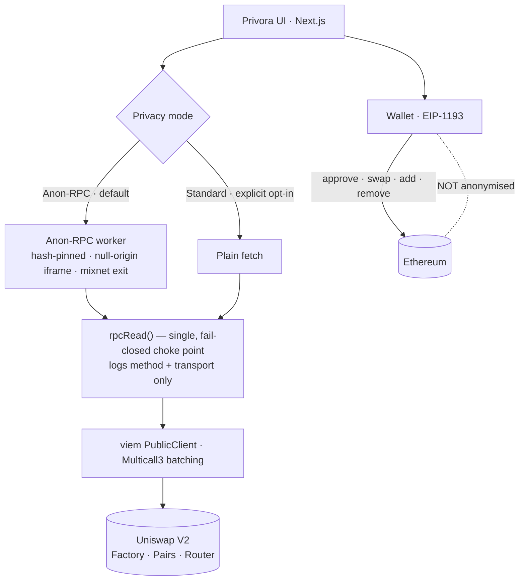
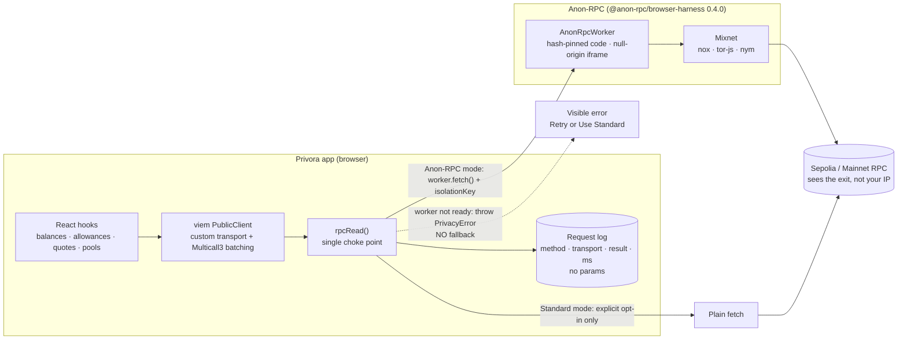
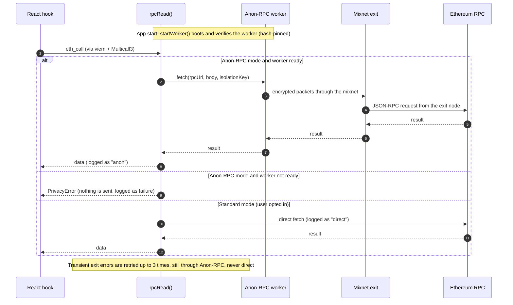

> **Privora v4** — this repo is Privora ported from Uniswap V2 to **Uniswap v4** on **Robinhood Chain testnet (46630)**. Start with `notes/00-PLAN.md` and `notes/01-findings.md`. The text below is from the V2 version and is being updated.

<div align="center">


# Privora

**Swap privately. Read anonymously.**

Uniswap V2 with every Ethereum read routed through [Anon-RPC](https://github.com/ethereum/anon-rpc) — so your RPC provider stops seeing your IP address next to your wallet's queries.


</div>

---

## Table of contents

[Why Privora](#why-privora) · [What it is — and isn't](#what-it-is--and-isnt) · [How it works](#how-it-works) · [Features](#features) · [Screenshots](#screenshots) · [Demo](#demo) · [Quick start](#quick-start) · [Configuration](#configuration) · [Testing](#testing) · [Project structure](#project-structure) · [Security & privacy model](#security--privacy-model) · [Limitations](#limitations) · [Documentation](#documentation) · [Licence](#licence)

## Why Privora

Every `eth_getBalance`, `allowance` or `getReserves` call from a normal dapp is a request from **your IP address** to an RPC company: *"this IP cares about this wallet and this pool."* That links your network identity to your wallet before you ever sign anything.

Privora removes that link for the **read path**. The Uniswap V2 experience is unchanged; what changes is *how the app reads the chain*.

## What it is — and isn't

| Privora **is** | Privora **is not** |
| --- | --- |
| The real, unmodified Uniswap V2 factory / pair / router, with a new frontend | A new AMM or a changed swap formula |
| A real integration of `@anon-rpc/browser-harness` in the read layer | A changed RPC URL, or a simulated "privacy" badge |
| Fail-closed: no worker ⇒ reads blocked, never a silent direct fallback | A way to hide your address or transactions onchain |
| Transparent: a live log of every request and the transport that carried it | A guarantee of anonymity (that depends on the Anon-RPC network's threat model) |

> **Anon-RPC anonymises chain _reads_.** Transactions are signed and broadcast by your wallet and are public onchain. Privora never claims otherwise.

## How it works



- **Reads** (balances, allowances, pairs, reserves, quotes, LP positions, token metadata, receipt polling) → `rpcRead()` → Anon-RPC worker.
- **Writes** (approve, swap, add/remove liquidity) → your wallet's own provider. Separate module, separate transport. Never routed through the read transport.
- **Fail-closed:** in Anon-RPC mode, if the worker isn't ready, reads throw `PrivacyError` before touching the network. The user can **Retry** or explicitly **Use Standard RPC**.
- **Isolation:** each wallet session gets a fresh random `isolationKey` (not derived from the address), rotated on connect and account change.

Deep dive: [docs/ANON_RPC_INTEGRATION.md](docs/ANON_RPC_INTEGRATION.md).

### Where do pools and quotes come from?

There is no price API, subgraph or aggregator. Everything is read from the Uniswap V2 contracts onchain, through Anon-RPC:

| What you see | Where it comes from |
| --- | --- |
| Quote and minimum received | `Router02.getAmountsOut(amountIn, path)`: direct pair first, or via WETH |
| Pool reserves, price, LP supply | `Pair.getReserves()` / `totalSupply()` for the pair from `Factory.getPair()` |
| Featured pools on the Pools page | `Factory.getPair(token, WETH)` for each featured token, batched with Multicall3 |
| Newest pairs on the Pools page | `Factory.allPairs(i)` for the newest pairs, batched with Multicall3 |
| Balances and allowances | ERC-20 `balanceOf` / `allowance` (and `eth_getBalance` for ETH) |
| Token symbol, name, decimals | Read from the token contract, then sanitised |

The default network is **Sepolia**, so the pools are Uniswap V2 test pools with arbitrary liquidity. The five featured tokens (USDC, LINK, DAI, USDT, UNI) were checked onchain to have a V2 pool against WETH with reserves. Mainnet is one environment variable away.

Token logos for well-known tokens are **bundled with the app** (`public/tokens`) and every other token gets an identicon generated from its address, so the page never contacts a logo CDN that could see your IP.

### How we built the Anon-RPC integration

Everything that reads the chain goes through one function, `rpcRead()`. It is the only place that can reach the network, so privacy is enforced in a single spot.



What happens on a read, step by step:



| Piece | File | Job |
| --- | --- | --- |
| Worker lifecycle and `rpcRead()` | `src/lib/anon-rpc/manager.ts` | Boot, verify, retry, self-heal; fail closed; request log |
| Network list | `src/lib/anon-rpc/networks.ts` | `nox` (default), `tor-js`, `nym`; blocks the non-anonymising `passthrough` worker |
| Read client | `src/lib/ethereum/read-client.ts` | viem client whose transport is `rpcRead()`; per-session isolation keys |
| Write path | `src/lib/ethereum/wallet.ts` | Wallet signing, a separate transport that is never routed through `rpcRead()` |
| Privacy page | `src/app/(app)/privacy/page.tsx` | Live read path, worker status, counters and request log |

Design rules we held to: no silent direct fallback, separate read and write transports, a fresh random isolation key per wallet session, and a log that cannot contain parameters, addresses or keys.

When the worker will not start, `startWorker()` abandons a stuck boot after 30 seconds, retries it three times, then tries each other anonymising network once. After a full failure it schedules another attempt in the background (up to 12 times). `bootOrder()` is unit-tested to guarantee that only anonymising networks are ever failover targets.


## Features

| Area | What you get |
| --- | --- |
| **Landing page** | Black, square, minimal. Leads with *why*: a plain-language problem statement (the librarian-and-ID-card analogy), a profile that builds itself from lookups alone, what that makes possible, why a VPN, mixers or your own node do not close the gap, and who needs it. Then a cursor-reactive dot-grid hero, four feature cards, an animated "same request, with and without Privora" diagram, a four-step flow, the architecture layers with the real Uniswap V2 addresses, what is and is not protected, and an FAQ |
| **Pitch deck** | `/pitch` is a six-slide animated deck (arrow keys to move, N for speaker notes, F for fullscreen) with measured numbers and a "Make a private read" button that sends a real call through the live worker |
| **Dashboard** | Sidebar app shell (bottom tab bar on phones) in the same style: Swap · Liquidity · Pools · Privacy · Settings, a dot-grid backdrop, pink corner brackets on the main cards and a live read-privacy status card |
| **Swap** | A **Live reads** panel beside the card shows each chain read and its route as it happens (also on Liquidity) · Token picker with real logos, popular-token chips and onchain address lookup · router quote (direct or via WETH) · price impact · minimum received · 0.3% fee · exact-amount approvals (never unlimited) · ETH↔token and token↔token swaps · ETH to USDC by default · Half / Max · slippage popover with presets and a custom value |
| **Fee-on-transfer tokens** | Transactions are simulated first; taxed tokens automatically use the router's `SupportingFeeOnTransferTokens` variants. Doomed transactions never reach your wallet |
| **Liquidity** | Add (new or existing pool, auto-paired amounts) · remove 25/50/75/100% · LP position and pool share · LP approval |
| **Pools** | **Featured pools** for real tokens (USDC, LINK, DAI, USDT, UNI) · newest factory pairs · smart search (symbol, name, token or pool address, optional second token) · live reserves, price, LP supply · token icons · deep links into Swap / Add liquidity |
| **Privacy page** | Live read-path diagram · worker status · per-transport counters · average latency · requests by method · filterable request log with Export JSON · "Kill worker" fail-closed demo · what is / isn't anonymised |
| **Settings** | Slippage presets and custom value, deadline, a worked example, and the built-in safety defaults |
| **Resilience** | Bounded concurrency, retries and worker self-heal for flaky mixnet exits. A 30-second start-up watchdog abandons a stuck worker, retries it, then fails over between anonymising networks (nox, tor-js, Nym). After a full failure the app keeps retrying in the background, so it recovers without a click. Receipts are polled with one small request every few seconds instead of viem's heavy default polling. Always back through Anon-RPC, never direct |

## Screenshots

| Landing page | How it works |
| --- | --- |
|  |  |

| The same request, with and without Privora | The problem: a profile builds itself |
| --- | --- |
|  |  |

| Swap with a live quote | Privacy page (live data) |
| --- | --- |
|  |  |

| Pools | Liquidity | Settings |
| --- | --- | --- |
|  |  |  |

<details><summary>Architecture section and mobile</summary>


 

</details>

## Demo

A 3 to 3.5 minute walkthrough (the older, shorter script is in [docs/DEMO_SCRIPT.md](docs/DEMO_SCRIPT.md)):

1. **The hook (15s).** On the landing page: a normal dapp tells an RPC provider who you are with every balance and quote read. The hero dots follow your cursor.
2. **The problem (15s).** Scroll to *The problem*: a profile of you builds itself from lookups alone.
3. **The idea (20s).** Scroll to *The request*: the same request twice. A normal dapp carries your identity to the provider; Privora strips it at the shield and mixes it through a mixnet.
4. **Open the app (15s).** Click *Open app*. The sidebar card shows the worker starting, then "Anon-RPC active". Connect a wallet on Sepolia.
5. **Quote and swap (45s).** Pick a real token such as USDC, enter an amount and show the live quote, price impact and minimum received (source: the Uniswap V2 router, onchain). Swap; your wallet signs and the receipt is polled through Anon-RPC.
6. **Privacy page (20s).** Private reads climb while **Direct reads stay at 0**; the log shows method, route and time, never parameters.
7. **Fail closed (20s).** Click **Kill worker**: reads stop with a visible message and the direct counter does not move. Restart the worker to recover.
8. **Pools and architecture (25s).** Featured pools for USDC, LINK, DAI, USDT and UNI, then the architecture section: one function, `rpcRead()`, is the only path to the network.
9. **Honest close (10s).** Transactions are still public onchain. Privora anonymises the reads that come before them.

The pitch video itself is built with scripts under `video/`, which is git-ignored (large files, never committed).

## Quick start

**Prerequisites:** Node.js 20+ (developed on 24), a browser wallet (MetaMask / Rabby) for transactions. Reads work without one.

```bash
git clone https://github.com/ayushsingh82/ethglobalmumbai.git
cd ethglobalmumbai
npm install
cp .env.example .env.local     # optional — defaults work
npm run dev                    # landing page at http://localhost:3200, app at /swap
```

Production: `npm run build && npm start`.

For transactions, switch your wallet to **Sepolia** (default chain) and get test ETH from any Sepolia faucet. For mainnet set `NEXT_PUBLIC_CHAIN_ID=1`.

## Configuration

All variables are public config — **no secrets are required**.

| Variable | Default | Purpose |
| --- | --- | --- |
| `NEXT_PUBLIC_CHAIN_ID` | `11155111` | `11155111` (Sepolia) or `1` (Ethereum mainnet) |
| `NEXT_PUBLIC_RPC_URL_SEPOLIA` | publicnode | RPC used directly in Standard mode and by the exit node in Anon-RPC mode |
| `NEXT_PUBLIC_RPC_URL_MAINNET` | publicnode | Same, for mainnet |
| `NEXT_PUBLIC_ANON_RPC_NETWORK` | `nox` | `nox`, `tor-js` or `nym` (the non-anonymising `passthrough` is blocked in Anon-RPC mode) |

Contract addresses are centralised in [`src/lib/ethereum/chains.ts`](src/lib/ethereum/chains.ts) and were verified onchain (router → `factory()` / `WETH()`).

| | Sepolia | Mainnet |
| --- | --- | --- |
| Factory | `0xF62c03E08ada871A0bEb309762E260a7a6a880E6` | `0x5C69bEe701ef814a2B6a3EDD4B1652CB9cc5aA6f` |
| Router02 | `0xeE567Fe1712Faf6149d80dA1E6934E354124CfE3` | `0x7a250d5630B4cF539739dF2C5dAcb4c659F2488D` |
| WETH | `0xfFf9976782d46CC05630D1f6eBAb18b2324d6B14` | `0xC02aaA39b223FE8D0A0e5C4F27eAD9083C756Cc2` |

## Testing

| Command | What it proves |
| --- | --- |
| `npm test` | Unit tests: V2 math vs. `UniswapV2Library` vectors, settings, fail-closed transport (**zero** `fetch` calls when the worker is down), log never stores parameters |
| `npm run typecheck` | Strict TypeScript |
| `npm run build` | Production build |
| `npm run e2e` | **Real headless Chrome, real Anon-RPC network:** worker boots and verifies · pools and a router quote are read through Anon-RPC · direct reads stay at 0 and the page makes no request to the RPC host after worker setup · Standard mode is labelled direct · killed worker fails closed with no fallback |
| `npm run e2e:ui` | **Real headless Chrome:** the landing page and every dashboard page render with no console errors and no horizontal overflow at 1280px and 390px; Open app, sidebar, mode toggle, settings persistence and the token selector work |
| `npm run e2e:tx` | **Real UI on a local Sepolia fork (anvil):** swap, exact-amount approve, taxed-token sell, add and remove liquidity — balances/allowances/LP verified onchain |
| `npm run e2e:sepolia` | **Real Sepolia, real transactions:** the app in Anon-RPC mode while a throwaway test wallet swaps, approves and sells; the Privacy page must show direct reads = 0. It navigates inside the app so the worker is not restarted (needs `PRIVORA_TEST_WALLET`, see the script header) |
| `npm run shots` | Regenerates the README screenshots from the running build |

`npm run e2e` needs a running production server (`npm run build && npm start`) and Google Chrome (override with `CHROME=/path`).
`npm run e2e:tx` setup is documented in the script header. Full results and honest caveats: [docs/TEST_REPORT.md](docs/TEST_REPORT.md).

## Project structure

```
src/
  app/(marketing)/        Landing page at /
  app/(app)/              Dashboard (sidebar): /swap · /liquidity · /pools · /privacy · /settings
  components/             AppShell (sidebar), MarketingNav, CursorWave (landing background), Brackets, ProfileBuild, art (animated SVG), WalletButton, ModeToggle, TokenIcon, TokenSelect, PoolCard, swap/, liquidity/ …
  lib/
    anon-rpc/             manager.ts (worker lifecycle · rpcRead choke point · request log) · networks.ts
    ethereum/             chains.ts · read-client.ts (viem on rpcRead) · wallet.ts (write path) · tx.ts
    uniswap/              abis.ts · pricing.ts (V2 math) · pools.ts (Multicall3-batched discovery)
    hooks.ts · tokens.ts · settings.ts · errors.ts
scripts/                  e2e-anon.mts · e2e-ui.mts · e2e-tx.mts · e2e-sepolia.mts · screenshots.mts · lib/cdp.mts (dependency-free Chrome driver)
public/tokens/            bundled token logos (served from the app's own origin)
docs/                     audit · Anon-RPC integration · demo script · test report · images
```

## Security & privacy model

- **No secrets.** Nothing sensitive is read or stored; all env vars are public config. No private keys in the repo (the e2e script uses anvil's public default dev account on a local fork only).
- **Approvals are exact-amount**, never unlimited.
- **Simulate before send:** swaps and removals are `eth_call`-simulated first, so reverts never cost gas.
- **No third-party requests from the page:** fonts are system fonts and token logos are bundled, so loading the app contacts only its own host. After the one-time worker setup, the page sends **no** request to the RPC host (checked from the browser's own resource log by `npm run e2e`).
- **Token metadata is untrusted:** read from the contract, sanitised, and non-ERC-20 addresses are rejected. Always verify the address, not the symbol.
- **The log is safe by construction:** `{id, ts, method, transport, ok, ms, error}` only — no params, addresses, URLs or keys (unit-tested).
- **What Anon-RPC does not protect:** your onchain address and transactions, your wallet extension's own RPC traffic, timing/behavioural correlation, a compromised exit, and the page host seeing your IP when you load the app.

## Limitations

- Public Anon-RPC networks are experimental: seconds of latency per request, and exits can be unavailable for minutes at a time (Nox has few TLS-capable exits). Privora retries, fails over between anonymising networks and keeps retrying in the background, but it can still be down: visibly, with Retry, and never silently falling back to a direct connection.
- Writes and the wallet's own RPC are **not** anonymised; the one-time worker bootstrap read and the page load are direct. Both are shown on the Privacy page.
- Wallet-signed flows are covered by automated tests with a stub wallet: on a local Sepolia fork (swap, approve, taxed-token sell, add and remove liquidity) and on real Sepolia (a swap, and an exact-amount approve plus sell, of USDC through Anon-RPC). The author also ran a swap and an add-liquidity manually on real Sepolia with a real wallet extension. Remove liquidity on real Sepolia and ERC-20↔ERC-20 swaps are implemented but not covered by a real-chain test.
- Multi-hop routing is limited to direct and via-WETH.
- Sepolia Uniswap V2 pools are test pools with arbitrary liquidity.

## Documentation

[Hackathon submission text](docs/SUBMISSION.md) · [Project audit](docs/PROJECT_AUDIT.md) · [Anon-RPC integration](docs/ANON_RPC_INTEGRATION.md) · [Earlier demo script](docs/DEMO_SCRIPT.md) · [Test report](docs/TEST_REPORT.md)

## Licence

MIT. Written from scratch against the published Uniswap V2 contract interfaces; no Uniswap interface (GPL-3.0) source is copied. "Uniswap" is a trademark of its owners — Privora is an unaffiliated project built for ETHGlobal Mumbai.
